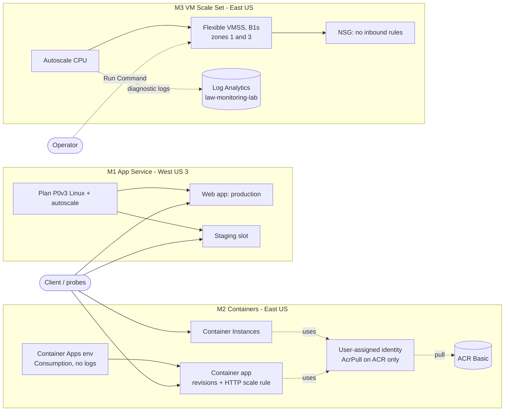

# Azure Compute and App Hosting Lab

Hands-on lab covering the main ways Azure runs workloads, and when to choose each: **App Service** (deployment slots, scaling, TLS), **containers** (Azure Container Registry, Container Instances, Container Apps), and **Virtual Machine Scale Sets** (zones and autoscale). Each part is built in the portal first, then codified in Bicep and verified with what-if, with controlled failures documented from real evidence.

Built as a hands-on project while studying for **AZ-104: Microsoft Azure Administrator**. This is lab work in a personal subscription, not a production environment.

> **Status (2026-11-03): complete.** M0-M4 done; all lab resources deleted (0 remaining). Plan and measured results: [`docs/plan.md`](docs/plan.md). Root-cause analyses: [`docs/rca/`](docs/rca/). Interview guide: [`docs/interview-guide.md`](docs/interview-guide.md).

## Architecture

Each milestone was built, tested and deleted on its own; they never ran at the same time.



## M1: App Service (done)

Built in the portal, then codified in [`infra/main.bicep`](infra/main.bicep):

- Linux App Service plan **P0v3** (West US 3, after a 0-quota block in East US) and a PHP web app
- **Staging slot** with a slot-sticky setting, swap and rollback, and a **warm-up health check** that blocks a broken build from being swapped in
- **Custom autoscale** on CPU, observed scaling out under load and back in
- **Scale up** P0v3 -> P1v3 -> P0v3 with an availability probe (measured about 20-30 s of errors on a single instance)
- **Access restrictions** tested with a reserved documentation IP (403 on production, staging unaffected)
- HTTPS only, TLS 1.2, FTPS only, basic auth disabled (deployments use Microsoft Entra ID)

**What-if** against the portal build showed **0 real drift** after two code fixes. A config export then found that the **staging slot accepted plain HTTP**; it was fixed through code and deployed with **0 failed production requests**.

### Evidence

All files are in [`docs/evidence/`](docs/evidence/) and are sanitized (subscription IDs, GUIDs, hostnames, IPs, email).

| File | Contents |
|---|---|
| `m1-00-quota-block.txt` | App Service quota of 0 in East US: timeline and outcome |
| `m1-01` .. `m1-05` | Plan and app, first deploy, slots and swap, blocked broken swap, manual scale-out |
| `m1-06-autoscale.txt` | Autoscale rules, scale-out and scale-in timeline, activity log times |
| `m1-07-scale-up.txt` | Scale-up and scale-down availability probes; autoscale caller identity |
| `m1-08-access-restrictions.txt` | 200 -> 403 -> 200 test; load endpoint removal |
| `m1-09-config-export.txt` | Live configuration export before codification; findings F1 and F2 |
| `m1-10-whatif-portal-vs-code.txt` | What-if passes 1-4 with a review of every reported change |
| `m1-11-staging-https-fix.txt` | F1 fix: what-if, deploy with production probe, before/after HTTP checks |
| `m1-12-teardown.txt` | Deletion and verification (0 resources left) |

### Rebuild

```powershell
az deployment group create -g rg-compute-lab --template-file infra/main.bicep --parameters infra/main.bicepparam
Compress-Archive app\* $env:TEMP\p6-app.zip -Force
az webapp deploy -g rg-compute-lab -n <app-name> --src-path $env:TEMP\p6-app.zip --type zip --clean true
az webapp deploy -g rg-compute-lab -n <app-name> --slot staging --src-path $env:TEMP\p6-app.zip --type zip --clean true
```

The plan bills about $0.08/hour whether or not the app is used. Delete it after testing: delete the autoscale setting, then the web app (its slot goes with it), then the plan.

## M2: Containers (done)

Codified in [`infra/m2.bicep`](infra/m2.bicep); app source in [`container/`](container/):

- **Azure Container Registry** Basic, admin user off; image built in the cloud with `az acr build` (no local Docker)
- **Azure Container Instances** pulling the private image with a **user-assigned managed identity**: first **denied** (no role), diagnosed as **authorization**, fixed with **AcrPull on the registry only**
- **Azure Container Apps** (Consumption, no log storage): private image via the same identity, ingress on 8080, **revisions and an 80/20 traffic split** (measured 80/20), **HTTP concurrency scale rule** (1 → 3 replicas in under 20 s, back to 0 after about 5 minutes)
- **Incident:** a new revision failed activation because portal-written health probes still targeted port 80; the old revision kept serving. Root cause found by comparing probe configuration across revisions; fixed with a new revision.

| Evidence | Contents |
|---|---|
| `m2-00-preflight.txt` | Providers, region availability, Container Apps and ACI quota |
| `m2-01-acr.txt` | Registry settings, cloud build, image digest |
| `m2-02-identity-and-aci-pull.txt` | Denied pull, diagnosis, AcrPull fix, running container |
| `m2-03-container-apps.txt` | Environment, app, probe incident, traffic split |
| `m2-04-scale-rule.txt` | HTTP scale rule: scale out and scale to zero |
| `m2-05-whatif.txt` | What-if of `infra/m2.bicep` against the built resources, with review |
| `m2-06-teardown.txt` | Deletion and verification |

**Rebuild (fresh):** set `pinnedRevisionName = ''` in `infra/m2.bicepparam`, deploy the registry, identity and role assignment, run `az acr build -r <acr> -t hello:v2 container`, then deploy the full template. (A single deploy fails on a fresh build because the app's first revision would try to pull an image that doesn't exist yet.)

## M3: Virtual Machine Scale Set (done)

Built in the portal, managed from the CLI (not codified in Bicep: see Limitations):

- **Flexible** scale set, Ubuntu 24.04, Trusted launch, B1s, Standard SSD, **zones 1 and 3** (B1s is restricted in zone 2 for this subscription: `NotAvailableForSubscription`)
- **No inbound ports**: per-instance public IPs for outbound only (Flexible scale sets have no default outbound access), NIC NSG with only the default rules (`DenyAllInBound`); management through **Run Command**
- **CPU autoscale** (out > 60%, in < 25%, min 2 / max 3) with a planned failure that became a real investigation ([RCA-005](docs/rca/rca-005-vmss-autoscale-nondeterministic.md)): autoscale's own observed value differs from and lags the metrics chart; evaluation logs showed flapping protection
- **Resize** of one instance B1s → B1ms in 33 s with a restart (memory 837 → 1842 MB); the scale set model stayed B1s (mixed sizes in Flexible mode)
- **Move** of an SSH key resource to another resource group **failed validation** (`ResourceMoveNotSupported`): not every resource type can be moved; the batch moved nothing

| Evidence | Contents |
|---|---|
| `m3-00-preflight.txt` | Zone restriction for B1s, quota, prices |
| `m3-01-vmss.txt` | Scale set, instances by zone, resources |
| `m3-02-nsg-and-runcommand.txt` | Effective inbound rules, Run Command, outbound check |
| `m3-03-autoscale-no-scaleout.txt` | Run 1: unexpected scale-out and investigation |
| `m3-04-autoscale-repeat-with-logs.txt` | Run 2: no scale-out; diagnostic logs |
| `m3-05-autoscale-distributed-load.txt` | Fix demo, evaluation logs, flapping protection |
| `m3-06-resize.txt` | Resize with before/after from inside the VM |
| `m3-07-move.txt` | Failed move and why |
| `m3-08-teardown.txt` | Deletion and verification |

## Root-Cause Analyses

| RCA | Incident |
|---|---|
| [RCA-001](docs/rca/rca-001-scale-up-outage.md) | App Service tier change caused ~20-30 s of errors on one instance |
| [RCA-002](docs/rca/rca-002-staging-slot-http.md) | Staging slot accepted plain HTTP (fixed through Bicep) |
| [RCA-003](docs/rca/rca-003-aci-acr-pull-denied.md) | ACI pull denied: authorization, not authentication |
| [RCA-004](docs/rca/rca-004-container-apps-probe-port.md) | Container Apps revision ActivationFailed: probes on the wrong port |
| [RCA-005](docs/rca/rca-005-vmss-autoscale-nondeterministic.md) | Scale set autoscale non-deterministic under uneven load |

## When to Choose Which (from this lab)

| Need | Choice | Evidence from the lab |
|---|---|---|
| Web app or API, deploy code, slots | **App Service** | Swaps, warm-up ping, autoscale in 5-6 min |
| One container on demand, billed per second | **Container Instances** | Created in seconds; no scaling or revisions |
| Containerized API that scales with requests, to zero | **Container Apps** | 1 → 3 replicas in < 20 s; back to 0 after ~5 min; revision traffic split |
| Full OS control, identical VMs, zones | **VM Scale Set** | You manage OS, networking, outbound access and load distribution yourself |

## Limitations and Possible Improvements

- **M3 is not codified in Bicep**; rebuild from the steps in `docs/plan.md` (M3 section).
- App Service ran in West US 3 because of the East US quota block; App Service quota support ticket outcome not recorded.
- Autoscale evaluation logs were not flowing during M3 runs 1-2, so the exact cause of run 1's evaluated value (60) is not determined.
- Production improvements: Health check and 2+ instances for App Service, HTTP probes on Container Apps, a load balancer for the scale set, autoscale diagnostic logs from creation, and CI/CD for the Bicep (as in Project 3).

## Cleanup

All resource groups are deleted. The budget `budget-compute-hosting-lab` is free and kept briefly to catch late charges; delete it when the final costs have posted:

```powershell
az consumption budget delete --budget-name budget-compute-hosting-lab
```

Also delete any downloaded SSH private key for `vmss-compute-lab_key`.

## Repository Layout

| Path | Purpose |
|---|---|
| `infra/main.bicep`, `infra/main.bicepparam` | M1 App Service build (plan, app, slot, settings, basic auth policy, autoscale) |
| `infra/budget.bicep`, `infra/budget.example.bicepparam` | $5 budget on the resource group (real alert email kept in a gitignored local file) |
| `infra/m2.bicep`, `infra/m2.bicepparam` | M2 containers (registry, identity + AcrPull, environment, container app) |
| `container/` | Container app source (`app.py`, `Dockerfile`): reports version, revision and replica; `/health`, `/slow` |
| `app/` | Test app: `index.php` reports version, slot setting and instance; `health.php` is the swap health check |
| `docs/plan.md` | Plan, costs, outcomes and deviations |
| `docs/rca/` | Root-cause analyses (5) |
| `docs/interview-guide.md` | Walkthrough, deep dives, likely questions |
| `docs/evidence/` | Sanitized command output for every milestone |
