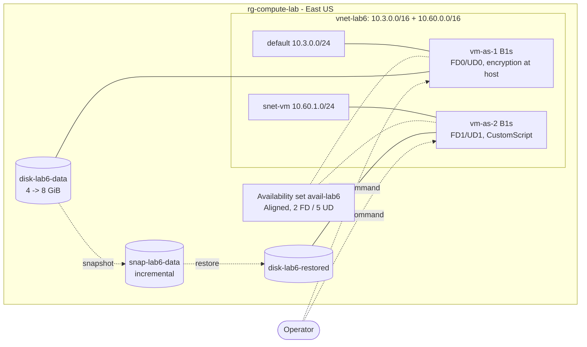

# Azure Compute and App Hosting Lab

Hands-on lab covering the main ways Azure runs workloads, and when to choose each: **App Service** (deployment slots, scaling, TLS), **containers** (Azure Container Registry, Container Instances, Container Apps), and **Virtual Machine Scale Sets** (zones and autoscale). Each part is built in the portal first, then codified in Bicep and verified with what-if, with controlled failures documented from real evidence.

Built as a hands-on project while studying for **AZ-104: Microsoft Azure Administrator**. This is lab work in a personal subscription, not a production environment.

> **Status (2026-11-05): complete.** M0-M4 done (2026-11-03); **Lab 6: VM operations** added 2026-11-05. All lab resources deleted (0 remaining). Plan and measured results: [`docs/plan.md`](docs/plan.md). Root-cause analyses: [`docs/rca/`](docs/rca/). Interview guide: [`docs/interview-guide.md`](docs/interview-guide.md).

## Architecture

Each milestone was built, tested and deleted on its own; they never ran at the same time.


## M1: App Service (done)

Built in the portal, then codified in [`infra/main.bicep`](infra/main.bicep):

- Linux App Service plan **P0v3** (West US 3, after a 0-quota block in East US) and a PHP web app
- **Staging slot** with a slot-sticky setting, swap and rollback, and a **warm-up health check** that blocks a broken build from being swapped in
- **Custom autoscale** on CPU, observed scaling out under load and back in
- **Scale up** P0v3 -> P1v3 -> P0v3 with an availability probe (measured about 20-30 s of errors on a single instance)
- **Access restrictions** tested with a reserved documentation IP (403 on production, staging unaffected)
- HTTPS only, TLS 1.2, FTPS only, basic auth disabled (deployments use Microsoft Entra ID)

**What-if** against the portal build showed **0 real drift** after two code fixes. A config export then found that the **staging slot accepted plain HTTP**; it was fixed through code and deployed with **0 failed production requests**.

### Evidence

All files are in [`docs/evidence/`](docs/evidence/) and are sanitized (subscription IDs, GUIDs, hostnames, IPs, email).

| File | Contents |
|---|---|
| `m1-00-quota-block.txt` | App Service quota of 0 in East US: timeline and outcome |
| `m1-01` .. `m1-05` | Plan and app, first deploy, slots and swap, blocked broken swap, manual scale-out |
| `m1-06-autoscale.txt` | Autoscale rules, scale-out and scale-in timeline, activity log times |
| `m1-07-scale-up.txt` | Scale-up and scale-down availability probes; autoscale caller identity |
| `m1-08-access-restrictions.txt` | 200 -> 403 -> 200 test; load endpoint removal |
| `m1-09-config-export.txt` | Live configuration export before codification; findings F1 and F2 |
| `m1-10-whatif-portal-vs-code.txt` | What-if passes 1-4 with a review of every reported change |
| `m1-11-staging-https-fix.txt` | F1 fix: what-if, deploy with production probe, before/after HTTP checks |
| `m1-12-teardown.txt` | Deletion and verification (0 resources left) |

### Rebuild

```powershell
az deployment group create -g rg-compute-lab --template-file infra/main.bicep --parameters infra/main.bicepparam
Compress-Archive app\* $env:TEMP\p6-app.zip -Force
az webapp deploy -g rg-compute-lab -n <app-name> --src-path $env:TEMP\p6-app.zip --type zip --clean true
az webapp deploy -g rg-compute-lab -n <app-name> --slot staging --src-path $env:TEMP\p6-app.zip --type zip --clean true
```

The plan bills about $0.08/hour whether or not the app is used. Delete it after testing: delete the autoscale setting, then the web app (its slot goes with it), then the plan.

## M2: Containers (done)

Codified in [`infra/m2.bicep`](infra/m2.bicep); app source in [`container/`](container/):

- **Azure Container Registry** Basic, admin user off; image built in the cloud with `az acr build` (no local Docker)
- **Azure Container Instances** pulling the private image with a **user-assigned managed identity**: first **denied** (no role), diagnosed as **authorization**, fixed with **AcrPull on the registry only**
- **Azure Container Apps** (Consumption, no log storage): private image via the same identity, ingress on 8080, **revisions and an 80/20 traffic split** (measured 80/20), **HTTP concurrency scale rule** (1 → 3 replicas in under 20 s, back to 0 after about 5 minutes)
- **Incident:** a new revision failed activation because portal-written health probes still targeted port 80; the old revision kept serving. Root cause found by comparing probe configuration across revisions; fixed with a new revision.

| Evidence | Contents |
|---|---|
| `m2-00-preflight.txt` | Providers, region availability, Container Apps and ACI quota |
| `m2-01-acr.txt` | Registry settings, cloud build, image digest |
| `m2-02-identity-and-aci-pull.txt` | Denied pull, diagnosis, AcrPull fix, running container |
| `m2-03-container-apps.txt` | Environment, app, probe incident, traffic split |
| `m2-04-scale-rule.txt` | HTTP scale rule: scale out and scale to zero |
| `m2-05-whatif.txt` | What-if of `infra/m2.bicep` against the built resources, with review |
| `m2-06-teardown.txt` | Deletion and verification |

**Rebuild (fresh):** set `pinnedRevisionName = ''` in `infra/m2.bicepparam`, deploy the registry, identity and role assignment, run `az acr build -r <acr> -t hello:v2 container`, then deploy the full template. (A single deploy fails on a fresh build because the app's first revision would try to pull an image that doesn't exist yet.)

## M3: Virtual Machine Scale Set (done)

Built in the portal, managed from the CLI (not codified in Bicep: see Limitations):

- **Flexible** scale set, Ubuntu 24.04, Trusted launch, B1s, Standard SSD, **zones 1 and 3** (B1s is restricted in zone 2 for this subscription: `NotAvailableForSubscription`)
- **No inbound ports**: per-instance public IPs for outbound only (Flexible scale sets have no default outbound access), NIC NSG with only the default rules (`DenyAllInBound`); management through **Run Command**
- **CPU autoscale** (out > 60%, in < 25%, min 2 / max 3) with a planned failure that became a real investigation ([RCA-005](docs/rca/rca-005-vmss-autoscale-nondeterministic.md)): autoscale's own observed value differs from and lags the metrics chart; evaluation logs showed flapping protection
- **Resize** of one instance B1s → B1ms in 33 s with a restart (memory 837 → 1842 MB); the scale set model stayed B1s (mixed sizes in Flexible mode)
- **Move** of an SSH key resource to another resource group **failed validation** (`ResourceMoveNotSupported`): not every resource type can be moved; the batch moved nothing

| Evidence | Contents |
|---|---|
| `m3-00-preflight.txt` | Zone restriction for B1s, quota, prices |
| `m3-01-vmss.txt` | Scale set, instances by zone, resources |
| `m3-02-nsg-and-runcommand.txt` | Effective inbound rules, Run Command, outbound check |
| `m3-03-autoscale-no-scaleout.txt` | Run 1: unexpected scale-out and investigation |
| `m3-04-autoscale-repeat-with-logs.txt` | Run 2: no scale-out; diagnostic logs |
| `m3-05-autoscale-distributed-load.txt` | Fix demo, evaluation logs, flapping protection |
| `m3-06-resize.txt` | Resize with before/after from inside the VM |
| `m3-07-move.txt` | Failed move and why |
| `m3-08-teardown.txt` | Deletion and verification |

## Lab 6: VM Operations (done, 2026-11-05)

Added after M0-M4 to cover the VM operations that the scale set milestone didn't: availability sets, restart vs redeploy, disk operations, encryption at host, and extension troubleshooting. Built in the portal, checked from inside the VMs with Run Command (no inbound ports, no public IPs), then codified in [`infra/lab6/vms.bicep`](infra/lab6/vms.bicep) and fixed through code.



| Milestone | What was tested | Result |
|---|---|---|
| M1 Availability set | 2 VMs in `avail-lab6`; remove a VM from the set; move it to another set | VMs placed in **FD0/UD0** and **FD1/UD1**. Removing was a **silent no-op** (exit 0, still in the set); moving was rejected: `PropertyChangeNotAllowed` |
| M2 Restart vs redeploy | Physical host (hashed), temp disk marker, OS disk marker, IP, FD/UD | Restart: **same host**, temp disk kept. Redeploy: **new host**, **temp disk wiped**, OS disk/IP/FD/UD kept; ~1 min 41 s request to boot |
| M3 Disks | Attach, format by LUN, snapshot online, expand online, restore to the other VM | Snapshot of a mounted disk worked; **4 → 8 GiB** online, but the guest needed a **rescan**, `growpart` and `resize2fs`; restored copy: **checksum match**, post-snapshot file **absent** |
| M4 Encryption at host | Register feature, enable on a running VM, deallocate → enable → start | Feature registered in **4 s**; running VM rejected (`OperationNotAllowed ... only when VM is in deallocated state`); SSE type unchanged. Disks created by the portal wizards allowed **export (AllowAll)**: all set to DenyAll |
| M5 Extension failure | Custom Script with a missing prerequisite ([RCA-006](docs/rca/rca-006-custom-script-extension-failure.md)) | Extension **Provisioning failed** while the VM stayed **Succeeded / Running**; root cause in the instance view stderr; fixed with an idempotent script |
| M6 Bicep | What-if against the portal build, then fixes through code | Pass 1: **0 real drift** (6 noise lines); pass 2: exactly 2 fixes (private subnets, disk tags); outbound **REACHABLE → UNREACHABLE** only after deallocate/start |

**Findings worth knowing**
- **An exit code of 0 is not proof.** `az vm update --remove availabilitySet` sent a real write that succeeded and changed nothing.
- **fstab by UUID saved the mount.** The data disk was `/dev/sdc1`, then `/dev/sda1` after a deallocate, then `/dev/sdc1` again; it mounted every time because fstab used the UUID with `nofail`.
- **Provisioning state is not health.** A failed extension left the VM `Succeeded`, and the portal Overview had no banner. The portal's "View detailed status" had the least detail (`ComponentStatus/ErrorClarification/failed/2`); the instance view had the stderr.
- **Default outbound access was on** in the VNet the VM wizard created (`defaultOutboundAccess` unset), although Microsoft's docs say the portal defaults to private subnets. The fix through code reached the VMs only after a stop (deallocate) and start.
- **Portal text on ADE:** *"Azure Disk Encryption ... will be retired on 15 September 2028 ... migrate to encryption at host"* and *"Azure Disk Encryption can't be enabled on disks that have encryption at host enabled."*

| Evidence | Contents |
|---|---|
| `lab6-00-preflight.txt` | Sizes and encryption-at-host support, availability set SKUs, quota, policy detail, prices |
| `lab6-01-availability-set.txt` | Placement by FD/UD, exposure, two negative tests, findings F1-F11 |
| `lab6-02-restart-vs-redeploy.txt` | Three probes from inside the VM and the summary table |
| `lab6-03-disks.txt` | Format by LUN, snapshot, online expansion, restore with checksum |
| `lab6-04-encryption-at-host.txt` | Feature registration, rejected change, enable, disk network-access fix |
| `lab6-05-extension-failure.txt` | Break, diagnosis (CLI, instance view, guest logs), fix |
| `lab6-06-bicep-whatif.txt` | Lint failure and fix, what-if passes 1-3, deploy, outbound before/after |
| `lab6-07-teardown.txt` | Final checks, inventory, deletion and verification |

**Rebuild from code** (a fresh rebuild needs the data disk to exist before attaching, and the restored disk only exists after the M3 restore, so remove `disk-lab6-restored` from `vm-as-2`'s `dataDisks` for a clean build):

```powershell
ssh-keygen -t rsa -b 4096 -f $HOME\.ssh\lab6_rsa
az group create -n rg-compute-lab -l eastus
az deployment group what-if -g rg-compute-lab -f infra/lab6/vms.bicep -p sshPublicKey="$((Get-Content $HOME\.ssh\lab6_rsa.pub -Raw).Trim())" applyFixes=true
```

Cost: 2 × B1s at $0.0104/h plus small Standard SSD disks and an incremental snapshot, for about 2.5 hours: estimated well under $0.25.

## Root-Cause Analyses

| RCA | Incident |
|---|---|
| [RCA-001](docs/rca/rca-001-scale-up-outage.md) | App Service tier change caused ~20-30 s of errors on one instance |
| [RCA-002](docs/rca/rca-002-staging-slot-http.md) | Staging slot accepted plain HTTP (fixed through Bicep) |
| [RCA-003](docs/rca/rca-003-aci-acr-pull-denied.md) | ACI pull denied: authorization, not authentication |
| [RCA-004](docs/rca/rca-004-container-apps-probe-port.md) | Container Apps revision ActivationFailed: probes on the wrong port |
| [RCA-005](docs/rca/rca-005-vmss-autoscale-nondeterministic.md) | Scale set autoscale non-deterministic under uneven load |
| [RCA-006](docs/rca/rca-006-custom-script-extension-failure.md) | Custom Script Extension failed while the VM reported Succeeded (Lab 6) |

## When to Choose Which (from this lab)

| Need | Choice | Evidence from the lab |
|---|---|---|
| Web app or API, deploy code, slots | **App Service** | Swaps, warm-up ping, autoscale in 5-6 min |
| One container on demand, billed per second | **Container Instances** | Created in seconds; no scaling or revisions |
| Containerized API that scales with requests, to zero | **Container Apps** | 1 → 3 replicas in < 20 s; back to 0 after ~5 min; revision traffic split |
| A few named VMs that must not fail together, one datacenter | **Availability set** (2-3 fault domains) | Lab 6: VMs placed in FD0/UD0 and FD1/UD1; the set can't be changed after creation |
| Full OS control, identical VMs, zones | **VM Scale Set** | You manage OS, networking, outbound access and load distribution yourself |

## Limitations and Possible Improvements

- **M3 is not codified in Bicep**; rebuild from the steps in `docs/plan.md` (M3 section). Lab 6 is codified (`infra/lab6/vms.bicep`), but leaves the snapshot, the restored disk, the extension and the auto-shutdown schedules out on purpose.
- Lab 6 VMs have no outbound internet after the fix (private subnets, no NAT gateway: blocked by the cost policy); Run Command still works.
- App Service ran in West US 3 because of the East US quota block; App Service quota support ticket outcome not recorded.
- Autoscale evaluation logs were not flowing during M3 runs 1-2, so the exact cause of run 1's evaluated value (60) is not determined.
- Production improvements: Health check and 2+ instances for App Service, HTTP probes on Container Apps, a load balancer for the scale set, autoscale diagnostic logs from creation, and CI/CD for the Bicep (as in Project 3).

## Cleanup

All resource groups are deleted. The budget `budget-compute-hosting-lab` is free and kept briefly to catch late charges; delete it when the final costs have posted:

```powershell
az consumption budget delete --budget-name budget-compute-hosting-lab
```

Also delete any downloaded SSH private key for `vmss-compute-lab_key`. The Lab 6 key (`~/.ssh/lab6_rsa`) was deleted in teardown.

Lab 6 registered the subscription feature `Microsoft.Compute/EncryptionAtHost`. It's free and does nothing until a VM uses it; it was kept. To remove it: `az feature unregister --namespace Microsoft.Compute --name EncryptionAtHost`.

## Repository Layout

| Path | Purpose |
|---|---|
| `infra/main.bicep`, `infra/main.bicepparam` | M1 App Service build (plan, app, slot, settings, basic auth policy, autoscale) |
| `infra/budget.bicep`, `infra/budget.example.bicepparam` | $5 budget on the resource group (real alert email kept in a gitignored local file) |
| `infra/m2.bicep`, `infra/m2.bicepparam` | M2 containers (registry, identity + AcrPull, environment, container app) |
| `infra/lab6/vms.bicep` | Lab 6: availability set, VNet, NSGs, NICs, data disk and two VMs; `applyFixes` adds private subnets and disk tags |
| `container/` | Container app source (`app.py`, `Dockerfile`): reports version, revision and replica; `/health`, `/slow` |
| `app/` | Test app: `index.php` reports version, slot setting and instance; `health.php` is the swap health check |
| `docs/plan.md` | Plan, costs, outcomes and deviations |
| `docs/rca/` | Root-cause analyses (6) |
| `docs/interview-guide.md` | Walkthrough, deep dives, likely questions |
| `docs/evidence/` | Sanitized command output for every milestone |
